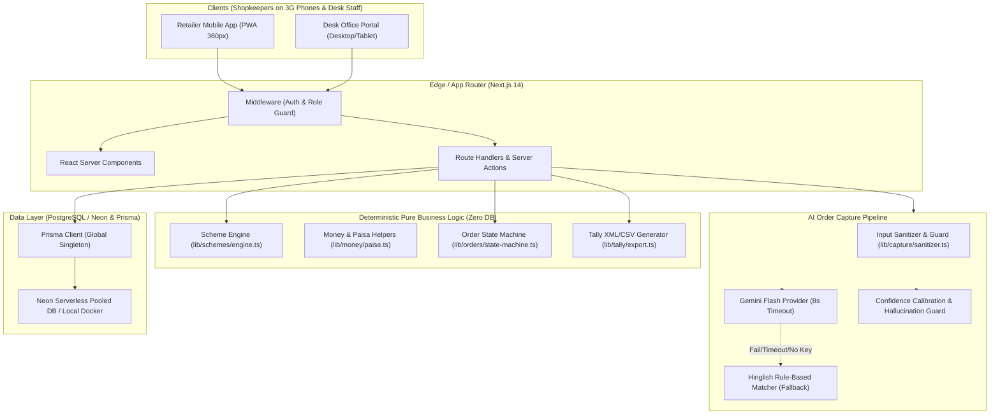
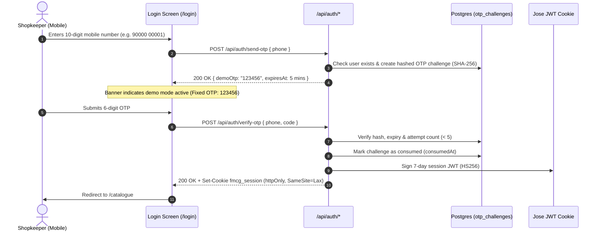
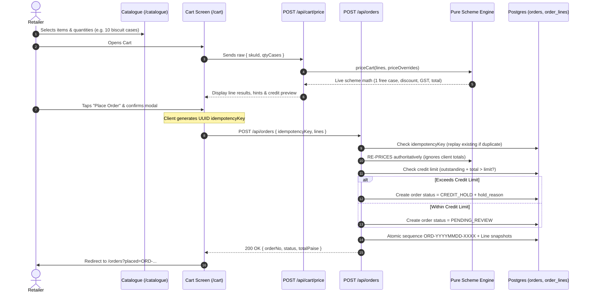
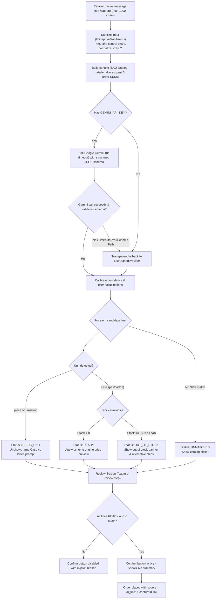
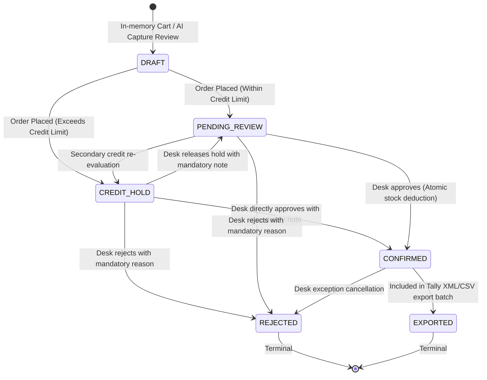
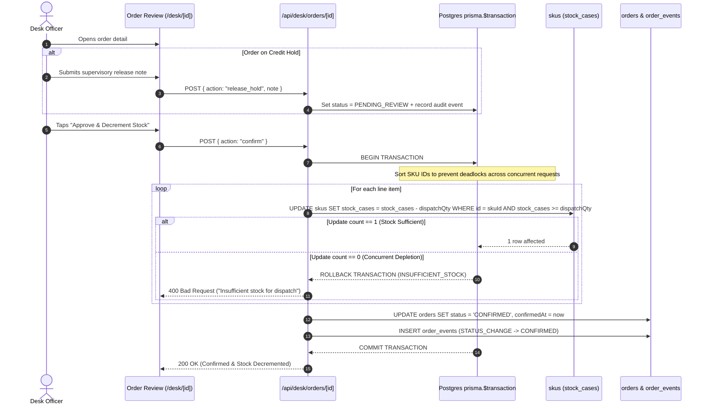
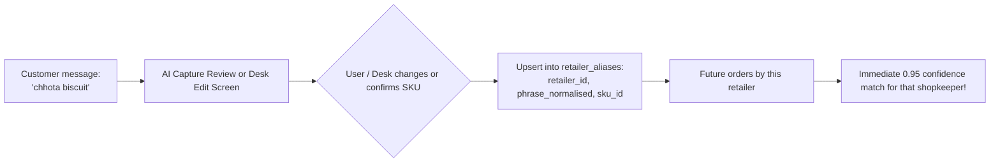
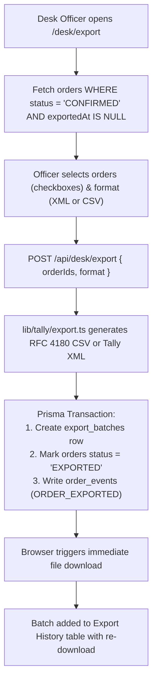
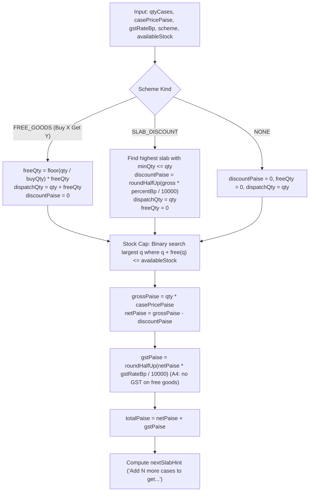
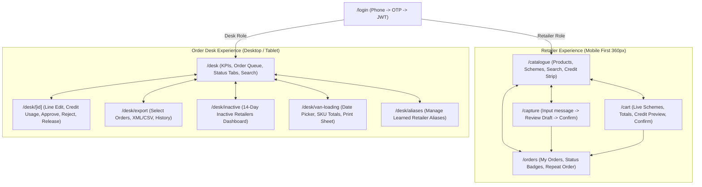

# System Workflows and Sequence Flows

This document details the sequence diagrams, state transitions, and user flow architectures implemented for Company A's FMCG Distributor Retailer Ordering App with AI Order Capture.

---

## 1. System Overview Architecture

---

## 2. Retailer Login (Mock OTP) Sequence

---

## 3. Catalogue -> Cart -> Order Placement (Server Re-Pricing)

---

## 4. AI Order Capture Sequence with All Branches

---

## 5. Order State Machine

---

## 6. Desk Review, Credit Release & Atomic Stock Deduction

---

## 7. Per-Retailer Alias Learning Loop

---

## 8. Tally ERP Export Flow

---

## 9. Scheme Engine Decision Flow

---

## 10. Screen-to-Screen Navigation Map

